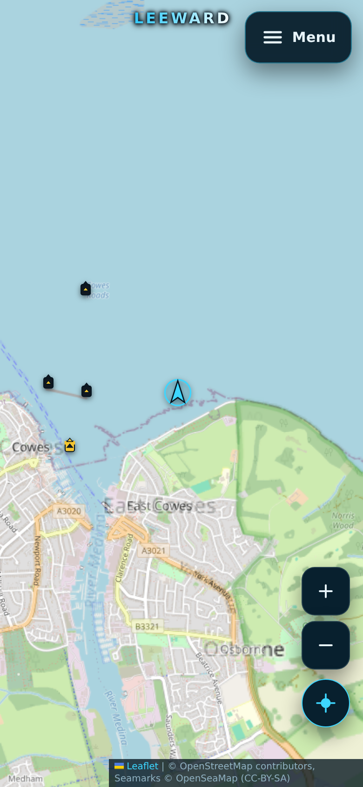

# WHEELOVER — Maritime Navigation and Planning

WHEELOVER is a mobile-first marine navigation chartplotter: a full-screen Leaflet chart, an
offline-capable NAVAID database, live AIS traffic, a searchable COLREGs guide and
wind, wave, tide and current dashboards. One control (top-right) opens every
setting; the
only chrome on the chart itself is the wordmark, a **+ / −** zoom stack and a
centre-on-me button — no docks, drawers or extra panels unless you open them.



## Run it

```bash
npm install
npm run dev          # http://localhost:3000
npm run build        # typecheck + browser bundle + production Node server
npm start            # serve dist/ plus /api/* and the shared AIS WebSocket relay
npm test             # unit tests
```

Both development and production need a persistent Node server (the AIS relay is a
WebSocket server). Static hosting alone cannot run `/ws/ais` or `/api/overpass`.
The production server serves `dist/`, the existing Overpass/depth proxies and
`/ws/ais` from one process; deploy with `npm ci && npm run build`, then `npm start`.
The npm package is `wheel-over`; LEEWARD/MARNAV remain only as legacy names for
importing device preferences and cached positions from earlier builds.
Set `AISSTREAM_API_KEY` as a private runtime environment variable on the host.
Do not add it to `VITE_*`, source code, or a client-side `.env` file: the server
uses it to open one upstream feed shared by the browser clients.

### After a workspace restore

Set `WHEELOVER_PREVIEW_HOST` (or pass `--host`) to authorize the current dev
preview hostname, and use `WHEELOVER_PORT` or `--port` to choose a port.

A restored Cloud workspace keeps the tracked files but loses `node_modules`, the
Playwright browser cache and every running process, and its preview hostname
changes. `scripts/dev-setup.sh` restores all of that, and it will not report the
server healthy until it answers a request carrying the current preview host:

```bash
./scripts/dev-setup.sh --host pv-…-….style.dev   # current preview hostname
./scripts/dev-setup.sh --stop                    # stop the server it started
```

It installs from `package-lock.json` only when the install tree is missing or
older than the lockfile, installs Chromium when Playwright cannot resolve a
binary, restores the shared libraries and fonts into `.browser-deps/` only when
`ldd` reports them missing, and then launches Chromium once to prove text
renders — the wordmark checks measure an empty box when it does not. It reuses
or starts the dev server on port 3000, checks that it listens on `0.0.0.0`, and
probes `/` with the preview `Host` header: a 403 there means the hostname is
stale, not that the server is down. `--port`, `--no-browser`, `--no-server` and
`--force` (reinstall dependencies) are the other flags. Port, host and PID are
kept in the git-ignored `.dev-server.env` and `.dev-server.pid`, so a re-run
only needs `--host` when the hostname has changed. `npm run setup -- --host …`
is the same thing.

### Environment

`AISSTREAM_API_KEY` belongs in `.env.local` (git-ignored) and is read only by
the server process:

```
AISSTREAM_API_KEY=your-key-here
```

The browser never receives the key: it opens `/ws/ais`, and the server holds the
upstream AISStream connection. For local production testing, `npm start` reads
`.env.local`; hosted deployments must set the same variable in their runtime
secret/environment settings. Without a key the relay serves clearly-labelled
**simulated** traffic so the station still works offline.

## What is in the chart

A bare **WHEELOVER** wordmark floats top-centre over the chart, filled with a
blue-to-white gradient and held together by a dark drop shadow the way a chart
label is drawn. It has no plate or border, so it reads over pale NOAA paper,
OSM and satellite imagery alike, and it is `pointer-events: none`, so it never
steals a map tap.

**Base charts**

- OpenStreetMap standard raster
- Esri World Imagery satellite
- **Nautical** — Esri Ocean base: bathymetric reference and sea names, worldwide
- **Relief** — Esri shaded relief over land and seabed, worldwide
- **NOAA ENC** — rendered from NOAA ENC Direct (`encdirect/enc_harbour`,
  `enc_coastal`, `enc_general` by zoom). US waters only; outside coverage the
  menu explains the limitation and no tiles are requested. Tiles are public
  domain and CORS-enabled, so each one is fetched once, stored in Cache Storage
  (the chart tile cache, retained from earlier builds so an existing offline
  pack survives the rename) and served from there afterwards: a second visit paints
  the same water from the device instead of waiting on NOAA's export service.
  **Check for updates** tops the pack up for the visible area — three zoom
  levels, up to 48 tiles — and reports how many were new and how many were
  already cached. Tiles older than 14 days are refreshed.
- **NOAA Raster** — NOAA's current Maritime Chart Service display, rendered per
  tile. NOAA retired the Raster Navigational Chart (RNC) tile service in 2022,
  so this is the live chart-style replacement rather than the old RNC mosaic.
  US waters only, with the same coverage guard as NOAA ENC.

**Overlays** (each independently toggleable, all in the menu)

- **Depth contours** — from zoom 9 in US waters this is NOAA ENC's charted
  depth-contour layer, drawn from the harbour/coastal band matching the zoom.
  Elsewhere it uses GEBCO's global 15-arc-second grid (nominally ~463 m
  north–south at the equator) and can optionally load local, viewport-filtered
  vector contour shards from the `/contours/` archive. Vector files use
  FlatGeobuf spatial indexes and HTTP byte ranges; the local archive is served
  from `WHEELOVER_CONTOUR_DATA_DIR`. Crisp line rendering does not add data
  resolution: GEBCO is a compiled model with mixed source quality and vertical
  references. These contours are not chart-grade and not for navigation.
  The legacy GEBCO tile fallback is upscaled beyond its zoom-10 native limit.
- **Depth numbers** — numeric depth labels sampled from the seabed grid for the
  current view, refreshed after each pan. GEBCO's 15 arc-second global grid
  answers the whole grid in one batch; inside European waters at zoom 14+ every
  other label is refined with EMODnet's ~115 m DTM. Values are depths below sea
  level, written in the Depth unit from Settings (feet, fathoms or metres) and
  rounded chart-style — one decimal in the shallows, whole units deeper. The
  numbers stay bare on the chart; the tooltip, the click popup and the menu hint
  carry the unit. These are modelled samples, not surveyed soundings.
- **Charted soundings** — the ENC's charted spot depths (`SoundingsP`), drawn as
  transparent tiles in a pane above the contours. Only available in US waters
  and only from zoom 15, where NOAA renders them; they keep the chart's printed
  unit (feet or metres). The menu says so when the chart is outside that
  coverage.
- OpenSeaMap seamark raster (transparent over any base)
- NAVAIDs from the local database
- **Ferry routes** — 190 charted crossings (Solent, the Channel ports, the
  West Country and New York), drawn as dashed cyan lines in their own pane
  above the chart and its depth layers.
- **TSS lanes** — 174 traffic separation features (lanes, zones, boundaries and
  lines) through the English Channel, the Dover Strait and the southern North
  Sea, drawn magenta with tinted lane fills (amber for separation zones).
- Both lane layers are OpenStreetMap data joined from the per-area snapshots in
  `data-raw/` by `npm run lanes:build`, and their ODbL credit appears on the
  chart only while one of them is switched on. A thin dark halo around the
  pane keeps the pale chart colours legible over NOAA paper, OSM land and
  satellite water; nothing is drawn where OSM has no mapped route, which the
  menu explains when either overlay is on.
- AIS targets

**Public places** (from OpenStreetMap, switched in the menu)

- **Marinas & berths**, **fuel & water**, **boatyard & chandlery**, **slipways
  & ramps**, **transport**, **food & drink**, **shops & provisions** and
  **ashore facilities** have their own pins and filters.
- Harbour services appear from zoom 11; town-scale classes (food, shops,
  facilities) wait until zoom 15, so a town cannot bury the channel at approach
  scale.
- Tap a pin for the name, kind, opening hours, phone, operator and website.
  OSM's marine tags (`leisure=marina`, `waterway=fuel`, `waterway=water_point`,
  `waterway=boatyard`, `leisure=slipway`, `shop=chandler`, …) are used directly;
  road filling stations are deliberately excluded.

**NAVAIDs**

- Tap/hover a mark for quick info, tap again for the full reference sheet
  (category, position, light character, colour, topmark, height, nominal range,
  source, OSM reference).
- IALA Region A/B symbol colours are chosen from the mark's position.
- **Major lights** use an eight-ray magenta star with a white core; **minor
  lights** use a violet four-stub flare inside a ring. The menu's symbol key
  shows the pair for the current IALA region.
- **Bifurcation (preferred-channel) marks** are a banded can or cone in the
  lateral colours, never the safe-water sphere — the two were identical before
  and a junction mark read as a safe-water mark.
- **Anchorage grounds** are a magenta dashed ring with an anchor, drawn from
  z12 and ranked above generic hazards so a harbour's anchorages survive
  declutter.
- **Transits (leading lights)** are split into **front (lower)** and **rear
  (higher)** classes, drawn as two dots on a dashed sight line with the filled
  dot marking this end of the transit. The two lights are paired by proximity
  (within 3 km), the leading line between them is drawn on the chart with the
  bearing to steer, and the reference sheet lists the role, the bearing, the
  distance between the marks and which mark it is paired with, with a button to
  jump straight to the other end of the pair. Inskip Islands in
  Esquimalt Harbour, for example, lines up on 015° true with the lights 89 m
  apart.
- **Wrecks** have their own symbol — a listing hull, half under the waterline,
  with broken timbers standing out of it and a gash in its side — instead of
  reading as an anonymous hazard. A wreck the source tags
  `dangerous` keeps the separate dangerous-wreck cross; a visible hull or a
  non-dangerous wreck is a plain Wreck. Drawn from z12 and ranked above generic
  hazards, so a wreck is not the mark that gets culled.
- **Anchor berths** (`seamark:type=anchor_berth`, the designated tanker berths
  common on Canadian coasts) use the same anchor inside a dashed square, so a
  berth is never mistaken for a general anchorage ground; the reference sheet
  carries its minimum depth and swinging radius.
- **Calling-in points** (Canadian Coast Guard radio reporting lines) are drawn
  as their dashed cyan line right across the channel, with a VHF handset icon at
  the line's midpoint for tapping, from z11. The quick info and reference sheet
  name the channel — for example `13 - West Porlier Pass · VHF Ch 11A`. Only
  these features keep their OSM geometry; every other way is still stored as a
  single point.
- **Legend & mark filters** in the menu lists every class the chart can draw as
  a switch — major/minor lights, lateral, cardinals, safe water, isolated
  danger, special, both bifurcation marks, transit/leading, anchorage, anchor
  berth, calling-in point, wreck, dangerous wreck, hazard, marina and the rest. Switching a class off removes it from the chart at once, before
  declutter runs, so hidden marks never eat into the marker budget; the
  `shown of total` line and the chips are the same source of truth. Choices
  persist in `wheel-over:chart-prefs` (previous `leeward:` and `marnav:` settings are still imported), and **Show every mark class** resets them.
- Zoom declutter hides minor marks until they are useful; **Show all marks**
  overrides it, and the menu always reports `shown of total` so nothing is
  silently dropped.

## NAVAID database

`npm run db:build` reads the raw Overpass snapshots in `data-raw/`, classifies
every seamark, merges duplicates and writes:

- `public/navaid-db/manifest.json` — version, regions, shard index, sources, stats
- `public/navaid-db/<region>/*.json` — per-cell shards (250 KB → 1 MB total)
- `src/data/solentNavaids.json` — 400-aid seed for instant first paint

Current build: **3,256 unique aids** from 3,693 raw records, **248 duplicates
merged**, two regions (Solent & Isle of Wight, New York Harbor), 21 shards.

The NOAA station indexes used for tides and currents are built the same way:
`npm run tides:build` writes 3,502 tide stations and `npm run currents:build`
writes 2,807 current stations into `src/data/`, from NOAA CO-OPS metadata.

Ingest, classification, dedupe and declutter all live in `shared/navaid-core.mjs`
and are imported by the app, the tests *and* the builder, so the database and the
chart can never disagree about what a mark is.

On the device:

- shards and the manifest are cached in IndexedDB keyed by database version;
- NOAA chart tiles for the area are cached in Cache Storage (see above), and the
  same **Check for updates** button refreshes both the database and the pack;
- the manifest is revalidated with `cache: 'no-store'` once a week
  (`shouldRevalidate`), and a new version drops the old shards;
- **Check for updates** in the menu forces the check;
- a pan into an area with no built shards falls back to the live Overpass proxy.

#### Local worldwide bathymetry contours (prototype)

The browser-side vector contour loader is in place, but it stays dormant until a
locally generated archive exists. It reads a manifest, selects only geographic
shards intersecting the current viewport, then uses FlatGeobuf's packed spatial
index and HTTP Range requests to download matching feature bytes. If a view
would select more than 64 MiB of shard files it is rejected instead of fetching
an impractical fraction of the planet. The local Vite and production Node
servers stream exact byte ranges from `WHEELOVER_CONTOUR_DATA_DIR`.

The Windows builder in `scripts/build-worldwide-contours.py` accepts the
released GEBCO_2026 GeoTIFF tiles and optional standard EMODnet DTM 2024 tiles.
It writes indexed 10-degree shards plus a manifest with actual coverage bounds,
bytes, source resolution, attribution and datum. It is designed to process
small crops with GDAL's cache capped at 512 MiB and does not upsample the source
raster. Its default shallow contours are 2 m steps from 2–5 m and 5 m steps from
5–10 m, followed by progressively wider depth bands; use `--intervals`, `--min-depth`
and `--max-depth` to customize them. GEBCO's nominal 15-arc-second grid spacing
is not uniform measurement
detail, and its assumed mean-sea-level reference has shallow-water exceptions;
EMODnet's standard DTM is referenced to LAT. Mixed-source seams are expected.
Nothing in these model contours is for navigation or safety at sea.

Start with a regional pilot and a separate scratch directory before any global
processing. Run from Miniforge Prompt after installing Node.js, GDAL, Osmium and
Pyosmium as already instructed:

```powershell
$env:WHEELOVER_CONTOUR_DATA_DIR = 'E:\\WHEELOVER\\contours'
python scripts\\test-worldwide-contours.py
python scripts\\build-worldwide-contours.py --gebco 'E:\\data\\GEBCO_2026\\gebco_2026_n50.0_s0.0_w0.0_e90.0.tif' --bounds -2 49.8 -0.8 51 --output 'E:\\WHEELOVER\\contours-pilot' --work-dir 'E:\\WHEELOVER\\contour-scratch'
```

The pilot `.tif` filename above is only an example: substitute the actual GEBCO
GeoTIFF downloaded from [the official GEBCO_2026 product page](https://www.gebco.net/data-products-gridded-bathymetry-data/gebco2026-grid).
Do not start a full global conversion until the pilot verifies correct raster
band selection, non-empty indexed shards, bounded memory and available disk.
The full GEBCO release uses eight 90-degree GeoTIFF tiles. Specify each tile
with a repeated `--gebco` option; `--bounds` can be omitted for full coverage.
Do not provide the accompanying TID grid as an elevation input. Generated
shards are not placed in Git automatically; the Vite app serves them locally
when launched with `WHEELOVER_CONTOUR_DATA_DIR`. For a hosted site, a separately
configured byte-range/CORS-capable public origin is still required; an ordinary
OneDrive share link has not been verified for this purpose.

`src/data/navaidSources.json` audits 16 chart sources (OpenCPN's list, C-MAP,
gpsnauticalcharts, i-Boating, UKHO, NOAA, BSH, LINZ, CHS and others) with
licence and redistribution terms. Only two can legitimately feed a bundled
database: **OpenStreetMap seamarks** (ODbL, used) and **NOAA ENC Direct**
(public domain, configured). The commercial suites have no public endpoints and
cannot be redistributed; their entries record why.

## Stations

The menu's *Stations* section carries AIS, the tracking card and the COLREGs
guide. Weather, tides and tidal current have their own drawer: the **Weather
conditions** button in the top-left corner of the chart opens the same panel
that used to sit in the menu.

- **AIS** — live vessels from AISStream through the relay, drawn like a traffic
  display: the hull is coloured by class (cargo green, tanker red, passenger
  blue, high-speed cyan, fishing orange, tug brown, pleasure and sailing
  violet, law enforcement slate, military olive) and outlined by navigational
  status (under way, at anchor, moored, restricted, aground). Under-way targets
  turn with their course; stopped ones become discs. Hover a target for a
  *Vessel details* card laid out the way the tracking sites lay theirs out: a
  title band above the name, type and transponder class, then the flag badge and
  country, then two labelled blocks — *Particulars* (IMO, MMSI, call sign, hull
  size, reported draught, navigational status) and *Voyage and position* (SOG,
  COG, destination, ETA, when the position was received). Tap it for a reference
  sheet split into *Particulars*, *Current trip* and *Position*, carrying the same
  fields plus the heading, the range and bearing from the chart centre and the age
  of the static report. A field the transponder has not sent prints `---` instead
  of vanishing, so a gap is visible as a gap. Hull size on
  both takes the length unit of the Distance setting, and the draught on both
  takes the Depth unit, so a target is quoted in the same units as your own
  boat. The same
  detail opens from a row in the station list, and each row carries its own
  **Centre** and **Tracking** buttons: Centre flies the chart onto that target
  while the drawer, the list and its scroll position stay put, and Tracking opens
  that target's Tracking info card straight away instead of going back through
  the picker. Whichever target you pick — a row, or the target itself on the
  chart — is ringed with a soft accent pulse, raised above the other hulls and
  labelled beside the ring with its name, course over ground and, once this
  device has a GPS fix, its range and true bearing off the boat
  (`selectedVesselLabelHtml`). Range follows the Distance setting and the label
  refreshes as the fix and the target move. Both outlive the sheet, so the
  vessel stays identifiable once it closes; tapping open water puts the ring and
  the label down. The flag — shown as a two-letter
  country-code badge, which does not depend on an emoji font — and the country
  name are decoded from the MMSI's Maritime Identification Digits (ITU-R
  M.585-9), including the special formats for coast stations, aids to
  navigation, SAR aircraft, craft with a parent ship and handheld VHF;
  emergency beacons carry no MID and show no flag.
- **Tracking info** — the AIS reference arranged as a card, in the shape the
  tracking sites use (`src/components/TrackingPanel.tsx`,
  `src/lib/tracking.ts`). Open it on a target with the **Tracking** button on its
  row in the AIS list, or choose one from the card's nearest-first list. It has
  three pages: *Overview* (status, SOG, COG, heading, position, range and
  bearing from the chart centre, report age, source), *Particulars* (type,
  MMSI, IMO, call sign, flag, size, draught, transponder class, static report)
  and *Voyage* (destination, reported ETA, status, speed, course, reported
  draught, range). A field the transponder has not sent reads "Not reported"
  rather than being guessed, and there is no port-call, ownership or photo
  data behind it. The page follows the live snapshot, and size, draught and
  position use the Distance, Depth and Coordinate settings. From the card you
  can centre the chart on the target, open its reference sheet, or pick another
  target.
- **AIS names arrive sooner.** The relay subscribes to Class A and Class B
  position reports, both static formats (`ShipStaticData`, `StaticDataReport`)
  and long-range broadcasts, keeps static records for hours regardless of chart
  scope, and the browser caches them in `wheel-over:ais-static` for 30 days — so a
  target that has been seen before shows its name on the first snapshot instead
  of a bare MMSI. A target heard for the first time can still be unnamed until
  its next six-minute static slot; the hover card and sheet say so explicitly.
- The relay reconnects with exponential backoff and keeps the last snapshot on
  screen while it does. Simulated mode is labelled. The upstream subscription
  follows the chart: the client sends the visible bounds (padded, clamped to a
  sane span) over `/ws/ais`, and the relay re-aims the AISStream subscription to
  that box, so a phone-sized view asks for a fraction of a degree instead of the
  whole planet. Two devices on different waters keep **one box each** (up to
  four) rather than a union over the ocean between them, every client is sent
  only the targets inside its own box, and targets outside a chart are dropped
  as soon as the scope moves.
- **COLREGs** — 40 offline entries across Parts A–E plus annexes, searchable by
  rule number, title, keyword or part, with regional modifications for the
  **US** (Inland Rules, 33 CFR 83/84), **Canada** (TP 14202) and **Europe**
  (CEVNI, IALA A). Summaries only, with links to the official texts.
- **Weather, tides & currents, worldwide** *(top-left Weather conditions)* —
  Open-Meteo wind, gusts, wave height/period, sea and air temperature and mean
  sea-level pressure for the chart position or GPS fix.
  Tides and currents are NOAA first: the nearest tide station within 120 km
  (harmonic predictions on MLLW) and current station within 60 km (flood/ebb
  sets, slack water, next turns, 12-hour curve, cosine-interpolated between
  published events). Outside that coverage the panel falls back to the
  Open-Meteo marine model (Météo-France SMOC, ~8 km): hourly sea level giving
  high/low water and a "now" height above mean sea level, plus surface-current
  set and drift in knots. Both station indexes are bundled lazy chunks
  (`src/data/tideStations.json`, `currentStations.json`; refresh with
  `npm run tides:build` / `npm run currents:build`), so station lookup never
  waits on NOAA's multi-megabyte metadata services.

## Display themes

Under *Settings → Map display* the menu offers Day, Night and Red, persisted in
`wheel-over:chart-prefs`. Earlier builds used `leeward:` and `marnav:` storage
prefixes; those saved settings are still read and rewritten under the new keys:

- **Night** dims the chart and panels while symbols keep their colours.
- **Red** is for dark adaptation. Tiles keep their channels and lose only the
  green/blue end through a full-map multiply tint, which preserves the red
  channel that carries land/water separation; symbols are desaturated first so
  nothing green or cyan survives. Every pixel ends up on a single red ramp,
  including the attribution link, and glare is capped well below daytime
  brightness. Port/starboard colour coding inevitably collapses to shape and
  brightness in red mode — that is the trade for a monochrome display.

The tint layer is `pointer-events: none` and sits below every control, so panning
and tapping are unaffected.

## Settings, profile and boat

*Settings* in the main menu holds the display choice, the unit conventions, and
the alert preferences. They live in `wheel-over:settings` in `localStorage` and
are validated on read, so a stale or hand-edited value falls back to the default
instead of breaking the panel.

- **Units** — distance (nautical miles with feet or yards, feet/yards with
  statute miles, metres with nautical miles or kilometres), speed (kn, mph, kph,
  m/s), depth (feet, fathoms, metres), bearing (true, magnetic, polar grid),
  relative bearing (360° or red/green), coordinates (lat/long, UTM/UPS, MGRS,
  GEOREF, AMG, NZMG, polar grid, ITM, Irish Grid), fuel (gallons, litres),
  temperature (°C, °F), wind speed (kn, mph, kph), pressure (bar, Pa, hPa, kPa,
  psi, inHg, mmHg, mbar) and rate of turn (°/s, °/min, rpm).
- **Live in the readouts** — the coordinate choice writes the position panel and
  the corner cursor readout (`src/lib/coordinates.ts`); speed converts the SOG
  figure; wind speed, temperature and pressure convert the conditions panel,
  which now reads mean sea-level pressure from Open-Meteo as well.
- **Notifications** — arrival, anchor drift, off course, shallow water and AIS
  proximity, plus alert sound and vibration. Anchor drift, off course, shallow
  water and AIS proximity all raise real chart alerts (see *Chart alerts* below);
  arrival is a stored preference only, and the app does not raise system
  notifications by itself.
- **My profile** — name, home port, experience and an emergency contact.
- **Boat settings** — name, type, length, beam, draught, MMSI and call sign.
  Length and beam are typed in the short unit of the chosen distance pair and
  draught in the chosen depth unit; all three are kept in metres behind the scenes.
  Draught is the figure the shallow-water alert compares against, so the alert
  reads the same unit back to you.

## Chart alerts

Four alerts are raised on the chart itself, in a stack above the bottom-left
controls (`src/components/ChartAlerts.tsx`, driven by `src/lib/alerts.ts` and
`src/hooks/useChartAlerts.ts`).

- **Shallow water** — needs a draught in Boat settings and the Shallow water
  switch on. The chart samples the modelled seabed at the vessel's fix (GEBCO,
  refined by EMODnet inside European waters) after every 150 m of movement or
  five minutes at rest, and compares it with the draught. No water left under the
  keel is a danger; less than a metre of margin is a caution. Depths are shown in
  the chosen depth unit.
- **AIS proximity** — needs the AIS proximity switch on. Any target inside half a
  nautical mile is reported with its distance, bearing, speed and whether it is
  closing on the vessel; inside a quarter mile it escalates to a danger. The
  range is written in the Distance unit from Settings, like the anchor circle.
- **Anchor drift** — needs an anchor dropped in *Anchor watch & course* and the
  Anchor drift switch on. Past the swing circle the card gives the distance and
  the bearing back to the anchor; past twice the circle it is a danger, which is
  an anchor that has broken out rather than a boat swinging on its scope.
- **Off course** — needs a course to steer in the same section and the Off course
  switch on. The card reads the heading (or the compass course when the device
  reports no heading) against the course, names the side of the turn and the
  number of degrees off; twice the tolerance is a danger. A vessel known to be
  stopped is not judged, and an unknown speed is judged on the heading alone.

Each card is dismissed on its own and comes back if the condition clears and
returns. The alert sound (a short chime, two-tone for danger) and vibration follow
their own switches. Turning a switch off stops the depth probing as well as the
card. The depth figures are modelled, not surveyed, so an alert is a prompt to
look at the chart.

## Anchor watch and course

*Anchor watch & course* in the menu holds the two watches the alerts read; the
state lives in `wheel-over:voyage-watch` and is validated on read
(`src/lib/voyageWatch.ts`).

- **Anchor** — *Drop anchor here* records the current fix and a swing circle
  (10–500 m, default 30 m); *Weigh anchor* clears it. The radius is a stepper:
  − and + move it in 10 m steps and stay inside the limits, while the figure can
  still be typed in full. It can be edited while the anchor is down, and a figure
  that is not a usable radius snaps back to the circle being drawn when the field
  loses focus.
- **Course** — type a course to steer in degrees true with a tolerance (3–60°,
  default 15°), or press *Hold current course* to take the heading being steered.
  *Clear course* removes it.

Both buttons need a live fix: without one they are disabled and the section says
so.

On the chart the watch is drawn in its own pane above the lanes and below the
marks (`MapCanvas.tsx`): a dashed amber swing circle with an anchor glyph at the
anchor itself and the radius written on the circle's northern edge, plus a
dashed cyan ray from the vessel along the course to steer with a chevron at its
end. The radius readout follows the stepper as it moves, so the circle can be
read without opening the menu. The ray is a screen length rather than a fixed
distance, so it reads the same at harbour zoom and at passage zoom, and it
follows the vessel as fixes arrive.

The stepper is in metres, and that is how the radius is stored, but the readouts
follow the Distance unit from Settings (`formatDistance` in
`src/lib/settings.ts`): the swing circle's label, the anchor drift card, the menu's
anchor status line (whose field hint also spells out the equivalent), the AIS
proximity card, the AIS station list, the vessel sheet's range, the transit gap and
heritage offsets on a mark sheet, the tide and current station distances in
Weather conditions, and the GPS accuracy figure. Feet, yards or metres are used
for short ranges and nautical or statute miles take over at the long end, so the
same 30 m circle reads `98 ft`, `33 yd` or `30 m`. A change of unit updates every
one of them on the spot.

Depths follow the Depth unit (`formatDepth` in `src/lib/depthLabels.ts` and
`formatDepthWithUnit` in `src/lib/settings.ts`): the modelled depth numbers, the
contour tooltips and popups, the shallow-water card, and the wreck sheet's charted
sounding, reported depth, wreck-top clearance and NOAA expected depth. A soundings
figure on a sheet keeps the mapped precision (`20.1 m`, or `66 ft`), while chart
labels round. Wreck depths arrive as raw OpenStreetMap tags, so a value carrying a
qualifier is shown exactly as mapped instead of being guessed at.

Quantities that are not depths keep their own units: bridge clearance is a height
above the water, light ranges and vessel dimensions stay in nautical miles and
metres, and the ENC's own charted soundings keep the chart's printed unit because
they are source raster.

## Vessel position

GPS is a persisted binary setting:

- **Always on** — a single `watchPosition` runs for the chart's lifetime; SOG and
  heading are derived from consecutive fixes when the device does not report them.
- **Always off** — the watch is never opened, the fix is cleared, and the panel
  explains that nothing is being requested.

The position panel is opt-in from the menu and shows coordinates, SOG, COG,
accuracy and a compass rose. Turning off GPS from the menu also clears the
on-chart vessel marker. `wheel-over:gps-mode` in `localStorage` remembers the choice.

**The chart opens on the vessel.** With GPS on, the last fix is cached in
`wheel-over:last-fix` (30-day expiry, validated on read) so a cold start lands in the
right place immediately; the first live fix then recentres once at harbour zoom.
That automatic move is cancelled by a deep link, by any pan or zoom, or after it
has run once — a chart that keeps jumping away from where the navigator put it
would be worse than one that starts slightly off.

A floating **centre-on-me** button sits bottom right, where a phone map puts it.
It recentres on the current fix, starts a fix request if one is still pending,
and otherwise explains itself in a short toast — including when GPS is set to
Always off, where it deliberately does not open a watch behind your back. A
**+ / −** zoom stack sits directly above it; the menu carries no chart actions,
and Leaflet's default zoom control is disabled so there is only one way to zoom.

## Deep links

`/?lat=40.70&lon=-74.03&z=13` opens the chart at a position and zoom — useful for
sharing a spot or reproducing a report. A deep link always wins over the cached
position and suppresses automatic recentring.

## Verification

```bash
npm run typecheck
npm test
npm run build
node scripts/verify-data.mjs                     # manifest, shards, seed, lanes, station indexes
npx playwright install chromium                  # once
node scripts/verify-ui.mjs                       # 132 browser checks + screenshots
node scripts/verify-lanes.mjs                    # ferry/TSS overlays actually paint
node scripts/capture.mjs 'http://127.0.0.1:3000/' shot.png  # one-off chart capture
node scripts/ais-probe.mjs 20                    # AISStream connectivity
```

`verify-ui.mjs` covers phone (390×844), tablet (820×1180), landscape phone and a
US/NOAA context: full-viewport chart, no horizontal overflow, ≥44 px controls,
single menu sections, NAVAID hover + reference sheet, GPS panel, live AIS,
COLREGs search, worldwide weather/tides/currents (NOAA in US waters, the global
model in the Solent), NOAA coverage guard, real NOAA raster content, cached NOAA
tile repaints and the chart-pack update check, and the right-hand tablet panel.
Screenshots land in `artifacts/`.

`verify-lanes.mjs` covers the lane overlays on their own: the chart opens with
only ferry and TSS switched on, at the Solent, Off Casquets, the Dover Strait and
in the night theme, and counts the lane colours in a real screenshot. A layer
that is added to the map but drawn invisibly, under another pane or without its
credit fails that run, as does one whose ink survives being switched off.

### Pushing from the desktop clone

GitHub and Render build from the desktop clone, but development happens in a
Freebuff workspace, and `git status` there only names files git already tracks: a
new module can sit untracked in the workspace, never reach the clone, and fail on
Render's `tsc --noEmit`. That is how `TrackingPanel.tsx` went missing.

The clone's pre-push hook compares both trees file by file — tracked and
untracked — and refuses the push while a file is missing from the clone, differs,
or exists only in the clone. Line endings are folded, so a CRLF checkout never
blocks a push.

```bash
npm run sync:check                        # compare once, without pushing
npm run sync:fix                          # copy missing and stale files into the clone
npm run sync:hook -- --source <workspace> # install the hook in the clone
```

`sync:fix` copies only the files the workspace has; a file the clone still
carries after the workspace dropped it is reported and left for you to `git rm`,
because deleting from the repository is a decision the script should not make.

Freebuff worktrees change path, so the hook records the workspace it was
installed against and asks to be re-run when that path disappears.
`WHEELOVER_CLONE` and `WHEELOVER_WORKSPACE` override the recorded paths.

On a minimal Linux container, headless Chromium may need `libnss3`, `libnspr4`,
`libatk*`, `libx*` and fonts. `scripts/setup-browser-deps.sh` extracts those
libraries into `.browser-deps/` (no root needed) and installs DejaVu into the
user font path:

```bash
./scripts/setup-browser-deps.sh
source scripts/browser-env.sh
node scripts/verify-ui.mjs
```

A missing font is not cosmetic: with no font, Chromium lays the wordmark out at
zero height, so the legibility checks measure an empty box and fail. A normal
desktop install already has the libraries and fonts and does not need this.

## Limitations

- **Anchorage, berth and calling-in coverage is as good as OSM's.** The built
  regions hold 9 anchorages and a single preferred-channel mark in the whole
  Solent, and 1 anchorage with 17 bifurcation marks around New York. If a mark
  is missing, it is usually not mapped in OSM yet — the app plots everything the
  ingest finds, and OpenStreetMap can be edited. Anchorage *areas* collapse to
  one anchor ground at the polygon's centre because the shards store points,
  not outlines. Calling-in points are the exception: their way geometry is kept
  and drawn as a line, so a bundled region needs a rebuild before those lines
  appear offline. Calling-in points only exist where a coastguard runs a radio
  reporting scheme (Canada's is the one mapped in OSM), so their absence
  elsewhere is expected rather than a bug.
- **Transit pairing is a proximity heuristic.** Front and rear lights are matched
  one-to-one with the nearest opposite light within 3 km, and the bearing is
  computed from their positions rather than read from a surveyed leading line,
  so it can differ by a degree or so from the charted transit bearing; OSM has no
  tag for the bearing itself. A light tagged only `leading`, with no upper/lower
  or front/rear role, stays a generic leading mark, and a pair split across two
  chart views only draws its line when both ends are on screen.
- **Only charted wrecks plot.** The query asks for `seamark:type=wreck`; bare
  `historic=wreck` and `man_made=wreck` tags are recognised if a source supplies
  them, but they are not requested from OSM because most of those are beached
  hulks, memorials or inland exhibits rather than navigation hazards.
- **OSM is the only worldwide, queryable, redistributable AtoN source.** Coverage
  is thin in some regions, and some features (e.g. `range_marker`) have no OSM
  tagging convention at all, so those marks can only appear where they are mapped.
- **NOAA ENC bands cover ports and approaches**, not every square mile. Blank
  chart paper means that band has no tile there; switch bands by zooming. NOAA is
  US-only and its export service is slow (roughly a second per tile), so the first
  visit to a stretch of water is still slow; cached areas and backed-up areas open
  at once. The cache is per browser and can be cleared by the browser.
- **NOAA's RNC tiles no longer exist.** NOAA shut the RNC Tile Service down in
  2022; the **NOAA Raster** base uses the live Maritime Chart Service display,
  which is ENC-derived and not the retired paper-chart mosaic. Neither is a
  certified navigation product.
- **No open surveyed-sounding source exists for UK/European water.** Chart-grade
  soundings and fine contours come from official ENC data. Outside the US the
  depth numbers are modelled grid samples: GEBCO at 15 arc seconds worldwide,
  refined by EMODnet's ~115 m DTM in Europe. Both are seabed models, not the
  hydrographer's plotted soundings, and EMODnet cells mix survey, satellite and
  interpolated sources. UKHO high-resolution surveys are download products, not
  public tile services. The global contour prototype uses GEBCO's grid and can
  optionally use EMODnet regional DTM; crisp rendering does not add source detail.
  The overlays are for passage planning and context, not for pilotage or chart datum.
- **Public places are community-mapped.** They come live from Overpass, are
  cached by the proxy for six hours, and can be incomplete, misplaced or out of
  date. A marina pin is not a surveyed chart feature and may not mark the
  entrance, fuel berth or visitor pontoon.
- **ENC depth overlays are US-only and render per tile.** Contours and
  soundings come from the same NOAA export service as the NOAA ENC base (about
  a second per tile on a cold view) and are not cached by the chart prefetcher.
  Soundings are only drawn from zoom 15, where the service includes them.
- **AISStream** drops upstream connections by design; the relay reconnects and the
  panel shows "Reconnecting". Vessel names and types arrive in separate static
  messages, so a fresh session shows some unnamed targets.
- **Outside NOAA coverage the panel uses a global model.** The Météo-France SMOC
  sea level and surface current come at ~8 km and hourly resolution. Tide
  heights are above mean sea level, **not chart datum**, and Open-Meteo states
  the data is not suitable for coastal navigation; the panel labels it as model
  guidance rather than pretending to a chart datum. Resolution is too coarse for
  harbour work and river flow is not modelled, so use official tide tables where
  they exist.
- **NOAA is preferred where it is local**: within 120 km of a tide station and
  60 km of a current station. Beyond that the model takes over instead of
  stretching a distant station's curve. The cosine between slack and peak is an
  approximation, and predictions are fetched for a 48-hour window; use the
  published station table when the exact turn matters.
- **The COLREGs view is a study aid**, not the legal text. Check the official
  convention, national modifications and local notices to mariners.
- Keep the shared AIS key in the production server's private environment settings,
  never in the browser bundle. Confirm AISStream permits public multi-user relay
  use before launch; the key being shared does not remove service rate limits.

## Attribution

Map data © OpenStreetMap contributors (ODbL). Seamark overlay © OpenSeaMap
(CC-BY-SA). Imagery © Esri, Maxar, Earthstar Geographics. Nautical and relief
bases © Esri, Garmin, GEBCO, NOAA NGDC, USGS. Charts © NOAA (public domain);
NOAA tide and current predictions © NOAA CO-OPS. Global depth contours © GEBCO 2026 (doi:10.5285/4f68d5c7-45eb-f999-e063-7086abc036fa); optional regional contours © EMODnet Bathymetry DTM 2024 (CC BY 4.0, doi:10.12770/cf51df64-56f9-4a99-b1aa-36b8d7b743a1). Depth numbers © GEBCO 2024 and EMODnet Bathymetry (CC BY 4.0). Public places © OpenStreetMap contributors (ODbL).
Sea-level
and surface-current model data © Météo-France SMOC via Open-Meteo (CC BY 4.0).
Forecasts from Open-Meteo. AIS data via AISStream.
